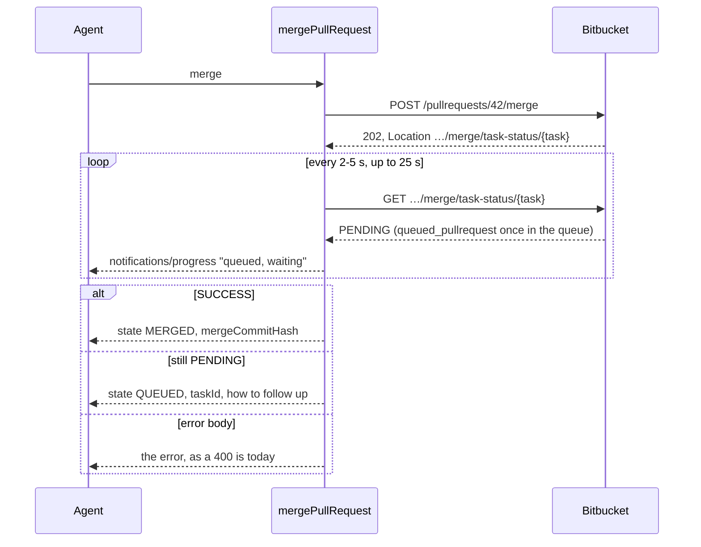

# Release 1.3.0 — the .NET 11-era toolchain on .NET 10 LTS, NUnit on MTP, merge queues and review gaps

.NET 11 shipped on 2026-11-10[^ga]. I measured it on throwaway copies of this repository, and moving the server to `net11.0` brings it nothing:
- The AOT binary grows 2%.
- Startup is the same.
- Support ends the same month as .NET 10 LTS.
- The `dnx` channel (and with it the Claude Code plugin) would stop working for anyone without the .NET 11 runtime.

What is worth taking is the tooling released alongside it:
- Fallout 10.5.0, which clears two high-severity advisories in `build/` and lets the `NuGet.Frameworks` pin go.
- MCP SDK 2.4.0.
- A test suite on **NUnit 5 and Microsoft.Testing.Platform (MTP)**, which replaces the xunit/VSTest bridge D11 was built around. CI gains failure annotations, which it has never had.

The same release closes the gaps an agent hits in real work:
- A merge into a branch with a Bitbucket **merge queue** is reported as an error today.
- "What blocks this merge?" cannot be asked at all.
- A comment cannot be corrected or withdrawn.

## What changes

### 1. The target framework stays `net10.0`

All numbers below were measured locally on copies of `HEAD`, with SDK 10.0.404 and 11.0.100 installed side by side.

| | `net10.0` on SDK 10.0.404 | `net11.0` on SDK 11.0.100 |
| --- | --- | --- |
| Build under `TreatWarningsAsErrors`, tests | green, 685 pass | green, no new warnings, 685 pass |
| win-x64 AOT binary | 19,540,480 B | 19,951,616 B (+2.1%, all from the runtime) |
| `initialize` round trip | ~90 ms | ~90 ms |
| Packages restored for the server | 21 | 12 (M.E.\*.Abstractions moved into the shared framework[^shared]) |
| Support ends | 2028-11 (LTS) | 2028-11-14 (STS) |
| `dnx bitbucket-mcp` on a machine with only .NET 10 | works | fails, unless the package also carries `net10.0` |
| `NuGet.Frameworks` pin in `build/` | not needed | required, at 8.0.0 |

The only real gain is the smaller restore graph, and it exists only with `net11.0` *alone*. Carrying `net10.0` too, so that `dnx` keeps working (verified: SDK 10 picks `tools/net10.0`, SDK 11 picks `tools/net11.0`), keeps the old graph in the repository and the package. So the server stays on .NET 10 LTS.

Revisit at .NET 12 LTS (November 2027). Revisit earlier only if RID-specific AOT tool packages ship first: they decouple `dnx` from the installed runtime (see *Out of scope*).

### 2. Toolchain and pins

`Directory.Packages.props`, app group, after the change:

```xml
<PackageVersion Include="ModelContextProtocol" Version="[2.4.0]" />
<PackageVersion Include="Microsoft.Extensions.DependencyInjection" Version="10.0.15" />
<PackageVersion Include="Microsoft.Extensions.Logging.Console" Version="10.0.15" />
<PackageVersion Include="System.Security.Cryptography.ProtectedData" Version="10.0.15" />
```

`build/_build.csproj` after the change. The `NuGet.Frameworks` reference and its comment are gone:

```xml
<PackageReference Include="Fallout.Common" Version="10.5.0" />
<PackageReference Include="Fallout.Components" Version="10.5.0" />
```

- **Fallout 10.4.0 → 10.5.0** (CLI in `.config/dotnet-tools.json` too). 10.4.0 restores `System.Security.Cryptography.Pkcs` and `Xml` 10.0.10, which now carry NU1902/NU1903 advisories; 10.5.0 brings 10.0.13. It regenerates `build.yml` and `publish.yml` byte-for-byte; only `.fallout/build.schema.json` changes. 10.5.0 also replaces SharpZipLib with SharpCompress behind `ZipTo`, which builds the Windows archives, so the release dry run must inspect a zip.
- **The `NuGet.Frameworks` pin is removed.** Its exit condition is met: Fallout 10.5.0 brings `NuGet.Packaging` 7.9.0, which is what SDK 10.0.4xx binds. I verified this on the path that used to fail: `dotnet fallout Test` with `GITHUB_ACTIONS=true`, where `ITest` evaluated the test project in-process. §3 removes `ITest` anyway, but `Compile` still evaluates projects through Fallout, so the check stays in *How it is verified*.
- **MCP SDK `[2.2.0]` → `[2.4.0]`**[^mcp]. Changes relevant here:
  - 2.3.0 makes `McpClient.ServerInfo` nullable (client side only) and keeps `tools/list` in registration order.
  - 2.4.0 fixes legacy output schemas for delegating tools.
  - The server compiles with zero warnings, all schema tests pass, and the binary grows 14 KB.
- **`build.ps1`** gains `$env:DOTNET_INSTALL_SKIP_TAR = "1"`, the line Fallout 10.5.0 added to its own template (Fallout#730). The repository's copy of the template never receives it otherwise.

### 3. Tests move to NUnit 5 on Microsoft.Testing.Platform

This uses the same setup as Jint: `EnableNUnitRunner`, `global.json` selecting MTP, `--report-github` for annotations. The test group of `Directory.Packages.props` becomes:

```xml
<PackageVersion Include="NUnit" Version="5.0.0" />
<PackageVersion Include="NUnit3TestAdapter" Version="6.3.1" />      <!-- the MTP runner, via EnableNUnitRunner -->
<PackageVersion Include="NUnit.Analyzers" Version="4.15.0" />
<PackageVersion Include="GitHubActionsTestLogger" Version="3.0.5" /> <!-- --report-github: annotations + job summary -->
<!-- removed: xunit.v3, xunit.runner.visualstudio, Microsoft.NET.Test.Sdk -->
```

```jsonc
// global.json
{ "sdk": { "version": "10.0.100", "rollForward": "latestFeature" },
  "test": { "runner": "Microsoft.Testing.Platform" } }
```

**Fallout's `ITest` cannot run this.** It speaks only VSTest (`--logger trx`, TRX parsing), and MTP support is still an open Fallout issue (Fallout#674). `Build` therefore drops `ITest` and gets the hand-written `Test` target that D11 named as its fallback:

```csharp
Target Test => _ => _
    .DependsOn<ICompile>()
    .Executes(() => DotNet(
        $"test --project {TestProject} --configuration {Configuration} --no-build " +
        $"--results-directory {ArtifactsDirectory / "test-results"}" +
        (GitHubActions.Instance is null ? "" : " --report-github"),
        environmentVariables: new Dictionary<string, string> { ["TESTINGPLATFORM_TELEMETRY_OPTOUT"] = "1" }));
```

The target keeps its name, so `dotnet fallout Test SmokeTest` and both generated workflows stay byte-identical.

**Semantics are kept, not just syntax.** xunit creates a new test-class instance per test and runs classes in parallel. Two assembly attributes give NUnit the same contract:

```csharp
[assembly: FixtureLifeCycle(LifeCycle.InstancePerTestCase)]
[assembly: Parallelizable(ParallelScope.Fixtures)]
```

The conversion covers 31 files: 346 `[Fact]`, 54 `[Theory]` with 237 `[InlineData]`, 10 `[MemberData]`, 286 uses of `TestContext.Current.CancellationToken`, and about 1,600 asserts. It is mechanical:

| xunit v3 | NUnit 5 |
| --- | --- |
| `[Fact]` | `[Test]` |
| `[Theory]` + `[InlineData(a, b)]` | `[TestCase(a, b)]` |
| `[MemberData(nameof(X))]` over `TheoryData<…>` | `[TestCaseSource(nameof(X))]` over `IEnumerable<TestCaseData>` |
| `TestContext.Current.CancellationToken` | `TestContext.CurrentContext.CancellationToken` |
| `Assert.Equal(expected, actual)` | `Assert.That(actual, Is.EqualTo(expected))`, **argument order flips** |
| `Assert.True(x)`, `Null`, `Contains(s, text)`, `Empty` | `Is.True`, `Is.Null`, `Does.Contain(s)` (`Has.Member` for collections), `Is.Empty` |
| `var x = Assert.Single(c)` | `Assert.That(c, Has.Count.EqualTo(1))`, then `c[0]` |
| `await Assert.ThrowsAsync<T>(…)` | `Assert.ThrowsAsync<T>(…)` (synchronous in NUnit: drop the `await`) |
| `Assert.SkipUnless(cond, why)`, `Assert.Skip(why)` | `Assume.That(cond, why)`, `Assert.Ignore(why)` |

NUnit.Analyzers runs under `TreatWarningsAsErrors`, and it already caught a swapped constant in the probe (NUnit2007). For swaps between two variables, nothing catches them but care. The count gate is the second check: the converted suite must discover exactly as many cases as xunit did, 686.

The new tests in Phase B are written in NUnit from the start.

What it buys and costs, measured:
- The test project's restore graph goes from 42 to 34 packages.
- `Microsoft.ApplicationInsights` 2.23.0 stays in it, through MTP's telemetry extension, which `NUnit3TestAdapter` requires. The `Test` target opts out with `TESTINGPLATFORM_TELEMETRY_OPTOUT=1`.
- CI gets a `::error` annotation per failing test and a job summary. A probe on SDK 10.0.404 produced both; today there are neither.

### 4. Release path: keep the Linux floor where it is

The released v1.2.1 `linux-x64` binary needs at most `GLIBC_2.34`; I read its ELF version-needs table. That binary is built on `ubuntu-latest`, which becomes Ubuntu 26.04 on 2026-11-19[^runner]. A newer build host can raise the glibc floor without anything noticing. `release.yml` therefore:
- pins the image, as `linux-arm64` already does;
- asserts the floor after the smoke test;
- gains a manual dry run, so the five legs can be checked on a branch before a tag:

```yaml
on:
  push:
    tags: ['v*']
  workflow_dispatch:          # dry run: build + smoke-test all five legs, publish nothing
...
          - os: ubuntu-24.04    # was ubuntu-latest; 26.04 would raise the glibc floor
            rid: linux-x64
...
      - name: 'Check: glibc floor'
        if: startsWith(matrix.rid, 'linux-')
        run: |
          max=$(objdump -T artifacts/publish/${{ matrix.rid }}/bitbucket-mcp | grep -o 'GLIBC_[0-9.]*' | sort -uV | tail -1)
          echo "requires $max"; [ "$(printf '%s\nGLIBC_2.34\n' "$max" | sort -V | tail -1)" = "GLIBC_2.34" ]
...
  release:
    if: startsWith(github.ref, 'refs/tags/v')
```

### 5. Merges that Bitbucket queues

On a destination branch with a merge queue, `POST …/merge` answers **`202` even when `async` is false**, with the task in `Location`. Bitbucket also answers 202 when a synchronous merge runs too long. Today both become an error telling the user to open the Bitbucket UI (`BitbucketApiClient.CreateQueuedMergeExceptionAsync`). `mergePullRequest` will instead follow the task for a bounded time and report progress while it waits:



`MergeResult` gains fields; existing ones are unchanged:

```jsonc
{ "state": "QUEUED", "mergeCommitHash": null, "taskId": "…",
  "message": "Bitbucket queued the merge. getPullRequest shows MERGED once it lands; getPullRequestMergeability shows it still queued." }
```

The task id is parsed out of `Location` and the URL is rebuilt with `BitbucketRequestBuilder`. A server-supplied URL is never followed, which is the same rule the cursors follow. Progress uses the SDK's `IProgress<ProgressNotificationValue>` parameter, which is bound per call and kept out of the input schema.

### 6. Merge readiness in one call: `getPullRequestMergeability` (new tool)

`GET …/pullrequests/{id}/mergeability/checks` (scope `pullrequest`, already held) is Bitbucket's own dry run of a merge:
- state;
- the caller's permission;
- git conflicts;
- every configured merge check (`minimum_approvals`, `minimum_successful_builds`, `resolved_tasks`, …);
- custom checks;
- merge-queue status, including `queued`.

Each check carries `status` and `blocking`. Today the skill approximates this with `getPullRequest` plus `listPullRequestStatuses`, and still cannot see unresolved tasks, a missing permission or a draining queue. The new tool returns the checks flattened, blocking ones first:

```jsonc
{ "mergeable": false,
  "checks": [
    { "type": "standard_merge_check", "kind": "minimum_approvals", "status": "FAILED", "blocking": true, "detail": "1 of 2 approvals" },
    { "type": "git_mergeability_check", "status": "PASSED", "blocking": false, "reason": "clean" } ] }
```

The endpoint has its own rate limit and an expensive git check. It is therefore a tool the merge playbook calls once, not a field on `getPullRequest`.

### 7. Answering a review

- **`updatePullRequestComment` (new tool):** `PUT` or `DELETE …/comments/{id}`. It takes `commentId` and exactly one of `content` or `delete: true`. It is destructive, because the old text is gone, and idempotent. Agents misplace inline comments regularly and today can only add a correction below the wrong one.
- **`getPullRequestComments`** sends `q=deleted=false`, so deleted comments are filtered server-side and pages are no longer silently short. It also gains `unresolvedOnly`: "show me the open threads" in one call.
- **`listPullRequests`** gains `reviewer` (the forms `author` accepts) and `destinationBranch`, composed into the existing BBQL filter. That answers "what is waiting for my review?" and "what targets `main`?".

### 8. Failing tests from Pipelines test reports (conditional)

`…/steps/{step}/test_reports/test_cases` and `…/test_case_reasons` (scope `pipeline`, the same as the other pipeline tools) name the failing tests without reading a log. `getPipeline` gains `includeFailedTests`, which returns at most 20 failed cases for the failed step. The OpenAPI spec documents no response body for these endpoints, so this part ships only if a live capture confirms the shape. Otherwise it moves to a later release.

With §6 and §7 the inventory grows from 20 to 22 tools. `tools/list` is 54,763 bytes today, about 2.7 KB per tool. `SmokeTest` will report the size so that growth is visible on every build.

### 9. A manifest the MCP Registry would accept

`io.github.lahma/bitbucket-mcp` is not in the official MCP Registry. Publishing there stays a later plan. The manifest and the README marker cost nothing now, and that matters: the registry checks ownership against the README **inside the published nupkg of that exact version**, so every version shipped without the marker can never be listed.

```jsonc
// .mcp/server.json
"$schema": "https://static.modelcontextprotocol.io/schemas/2025-12-11/server.schema.json",   // was 2025-10-17
"description": "Bitbucket Cloud pull requests and Pipelines: review, comment, merge, diagnose builds.",  // ≤ 100 chars; was 193
"registryBaseUrl": "https://api.nuget.org/v3/index.json"                                       // was https://api.nuget.org, rejected
```

```markdown
<!-- mcp-name: io.github.lahma/bitbucket-mcp -->   (top of README.md, which the package already packs)
```

## Steps

**Phase A: toolchain and release path**

- [x] 1. `Directory.Packages.props`: the app versions in §2.
- [x] 2. `build/_build.csproj`: Fallout 10.5.0, delete the `NuGet.Frameworks` reference and its comment. `.config/dotnet-tools.json`: `fallout.globaltool` 10.5.0. Run the build once and commit the regenerated `.fallout/build.schema.json`.
- [x] 3. `build.ps1`: add the `DOTNET_INSTALL_SKIP_TAR` line with a one-line why.
- [x] 4. `.github/workflows/release.yml`: `ubuntu-24.04` for `linux-x64`, the glibc check, `workflow_dispatch`, and `if:` on `release`. Update the header comment to say why the image is pinned.
- [x] 5. `build/Build.cs`: reword the R2 comment above the `tar` call. It names SharpZipLib, which 10.5.0 replaced; the reason to keep the `tar` CLI (proven modes) stands. `SmokeTest`: add the `tools/list` byte count to `ReportSummary`.

**Phase T: tests to NUnit 5 on MTP** (before Phase B, so that new tests are born NUnit)

> Done as planned, with three findings folded in:
> - NUnit 5's `ThrowsAsync`/`CatchAsync` return `Task<T?>`: they are awaited, and the call sites that use the exception go through `Expect.Throws`/`ThrowsAsync`/`CatchAsync`, which return it non-null.
> - NUnit's string constraints compare with the current culture and `Does.Contain(string)` has no `Using(StringComparison)`. The test project therefore runs with `InvariantGlobalization`, as the server does, which makes them ordinal.
> - Fallout's `.Produces()` no longer lists TRX files, so the regenerated `publish.yml` drops its `test-results` upload.

- [x] 6. Baseline first. On the unconverted tree, save `dotnet test tests/Bitbucket.Mcp.Tests --list-tests` (still VSTest) to a scratch file outside the repository. It is the count gate: 686 cases.
- [x] 7. Packages and runner (§3):
  - the test group of `Directory.Packages.props`;
  - the test csproj: `EnableNUnitRunner`, the four references, `<Using Include="NUnit.Framework" />`, remove the xunit references;
  - the `global.json` `test` block;
  - a new `tests/Bitbucket.Mcp.Tests/TestAssembly.cs` holding the two assembly attributes, with a comment that they keep xunit's per-test instance and per-class parallelism.
- [x] 8. `build/Build.cs`:
  - remove `ITest` from the interface list and its two members (`TestProjects`, `TestSettings`);
  - add the `Test` target from §3, plus a `TestProject` path beside `ServerProject`;
  - `Main` becomes `Execute<Build>(x => x.Test)`;
  - update the class `<remarks>`, which says Test comes from Fallout.Components.

  In `build/Build.CI.GitHubActions.cs`, change `nameof(ITest.Test)` to `nameof(Test)` in both attributes. Run the build and confirm `build.yml` and `publish.yml` regenerate unchanged.
- [x] 9. Convert the 31 test files with the table in §3, one directory at a time (`Authentication/`, `Diffs/`, `Http/`, `Pipelines/`, `Tools/`, root), building after each:
  - `TokenStoreTests`' two platform skips become `Assume.That` and `Assert.Ignore`;
  - `ToolSchemaTests`' and `ToolInventoryTests`' per-tool rows become `[TestCase]`;
  - nothing may be deleted or weakened to make it pass (AGENTS.md *Testing*).
- [x] 10. Count gate: `dotnet test --project tests/Bitbucket.Mcp.Tests --list-tests` lists 686 cases. Then `.\build.ps1 Test` is green. Run it once with `GITHUB_ACTIONS=true` and a deliberately failing assert, and see the `::error` line; revert the assert.
- [x] 11. `AGENTS.md`, for Phases A and T:
  - D11 rewritten: NUnit on MTP, a hand-written `Test` target because Fallout's `ITest` is VSTest-only (Fallout#674), `GitHubActionsTestLogger` for annotations, and the revisit trigger (Fallout ships MTP support).
  - *Package budget*: the tests line names the four packages.
  - *Package budget changes*: a dated entry with the evidence (graph sizes, advisories, the simulated GitHub Actions run, the probe).
  - *Held deliberately*: remove the xunit and `NuGet.Frameworks` sentences. Add "stays on `net10.0`" with the §1 table in two lines, and the revisit trigger.
  - *Build*: Fallout 10.5.0 is the stable line.
  - *Testing*: the commands become `dotnet test --project tests\Bitbucket.Mcp.Tests [--filter …]`, and "xunit.v3 with the VSTest bridge" becomes NUnit on MTP.
  - R2: drop the SharpZipLib wording.
  - A new D23 row records the target-framework decision.

**Phase B: tool surface** (tests in NUnit)

- [ ] 12. Merge queues (§5):
  - `BitbucketApiClient.MergeAsync` returns the PR on `200`, or the task id on `202`.
  - New `GetMergeTaskStatusAsync` plus `MergeTaskStatusDto` (extend the existing one) with `merge_result` and `queued_pullrequest`.
  - In `mergePullRequest`, poll with an internal budget and interval (tests pass zero, so no fake-clock package is needed) and report progress.
  - Remove `CreateQueuedMergeExceptionAsync`, the `202 => Queued` branch in `ToolErrors` and its README troubleshooting entry, since nothing produces them any more.
  - Tests: 202 → SUCCESS, 202 → still PENDING (`QUEUED` result), 202 → error body, and a `Location` with a foreign host or path (refused).
- [ ] 13. `getPullRequestMergeability` (§6): `MergeabilityCheckDto` with the per-type fields (`check.kind`, `reason`, `queued`, `state`), a `ResultMapper` method, the tool in `PullRequestReadTools` (ReadOnly, Idempotent, OpenWorld), and a fixture-backed test. An unknown `type` passes through as-is rather than failing the call. Capture one live response into `Fixtures/` first.
- [ ] 14. `updatePullRequestComment` (§7) in `PullRequestWriteTools` (Destructive=true, Idempotent=true). Refuse both or neither of `content`/`delete`. Tests for edit, delete and the arity guard.
- [ ] 15. `getPullRequestComments`: add `q=deleted=false` in `GetCommentsAsync` and an `unresolvedOnly` parameter. Try `resolution=null` in BBQL against a live repository first; if Bitbucket refuses it, filter client-side and say so in the description. Keep the `ResultMapper.Comments` deleted check as a backstop and say why in its comment.
- [ ] 16. `listPullRequests`: `reviewer` and `destinationBranch` through the existing BBQL composer (`BitbucketApiClient.cs` around line 1019) and `ToolDefaults.ResolveBranchFilter`'s refusal rule for quotes and backslashes.
- [ ] 17. Test reports (§8): capture live responses into `Fixtures/` first. If the shape is usable, add `includeFailedTests` to `getPipeline`, a field set that includes `next` (`FieldSetTests` enforces it), and tests. While in `FieldSets.cs`, move the misplaced `Task` doc comment that sits above `Pipelines` back to `Task`. If the shape is not usable, drop the step and record why here.
- [ ] 18. Inventory in its six places for the two new tools:
  - the AGENTS.md *Tool table*;
  - `ToolInventoryTests` (names, counts, annotation rows);
  - `Build.cs` `ExpectedToolNames`;
  - `.claude/skills/bitbucket-pull-requests/SKILL.md`: merge playbook mergeability → merge → follow a queued merge; review playbook correct or withdraw a comment, `unresolvedOnly`;
  - the `ToolSchemaTests` rows;
  - README tool table and the count, 20 → 22.

  Also add `IProgress<ProgressNotificationValue>` to `ToolInventoryTests.InjectedParameterTypes` and `progress` to `ToolSchemaTests.NeverInSchema`.

**Phase C: release**

- [ ] 19. Registry-ready manifest (§9): update `.mcp/server.json` (`$schema`, a description of at most 100 characters, `registryBaseUrl`) and add the `mcp-name` comment to `README.md`. Extend `McpServerManifestTests`:
  - `description.Length <= 100`;
  - `registryBaseUrl` is exactly the NuGet index URL;
  - `$schema` names the 2025-12-11 schema;
  - `README.md` contains `mcp-name: ` followed by the manifest's `name`.

  The sonarqube-mcp repository makes the same change in its next release; keep the two in the same shape.
- [ ] 20. `CHANGELOG.md` `# 1.3.0`, and the version in `.mcp/server.json` (both fields), `.claude-plugin/plugin.json` with its `dnx` pin, and the `VersionPrefix` fallback in `Directory.Build.props`. The manifest tests enforce all of these. In the changelog, add lines on the Linux glibc 2.34 floor, merge-queue behavior, and the move to NUnit on MTP (for contributors).
- [ ] 21. Run `release.yml` by `workflow_dispatch` on the branch. All five legs must be green, the Linux legs must print `requires GLIBC_2.34` or lower, and the win-x64 zip, now built with SharpCompress, must download, extract and run `bitbucket-mcp status`.

## How it is verified

- [ ] `.\build.ps1 Test` and `.\build.ps1 SmokeTest` are green locally, and `SmokeTest` lists all 22 tools.
- [ ] The converted suite discovers at least the 686 baseline cases, plus the new tests from Phase B.
- [x] `GITHUB_ACTIONS=true dotnet fallout Test` is green with no `NuGet.Frameworks` reference, and a deliberately failing assert produces a `::error` annotation.
- [ ] `dotnet list build/_build.csproj package --vulnerable --include-transitive` reports nothing.
- [ ] Live, against a real workspace:
  - merge into a branch with a merge queue: progress appears, and the call returns `QUEUED` or `MERGED`;
  - `getPullRequestMergeability` on a PR missing an approval shows that check blocking;
  - edit and then delete one's own comment;
  - `unresolvedOnly` on a PR with mixed threads;
  - a failed step with JUnit output, for step 17.
- [ ] The release dry run (step 21) is green on all five runners.
- [ ] The packed `artifacts/packages/bitbucket-mcp.1.3.0.nupkg` contains `README.md` with the `mcp-name` line, and `.mcp/server.json` with the new fields.

## Decisions

| Decision | Choice | Why |
| --- | --- | --- |
| Target framework | Stay `net10.0` on SDK 10.0.4xx (chosen in review) | Measured: no size or startup gain on 11, same support end, and `dnx` keeps working for .NET 10 users |
| If moving to .NET 11 later | `global.json` 11.0.100; `net11.0` in `Directory.Build.props` and `build/_build.csproj`; `NuGet.Frameworks` **8.0.0** pin; M.E.\* 11.0.0; optionally `TargetFrameworks=net10.0;net11.0` on the server plus `.SetFramework("net11.0")` in `PublishAot` | All verified green; without the pin a simulated CI run fails with `Could not load … NuGet.Frameworks, Version=7.11.0.0` |
| Test framework | NUnit 5 on MTP (chosen in review) | The user's choice, matching Jint; replaces the VSTest bridge D11 was holding xunit at 3.x for |
| How tests run under Fallout | Hand-written `Test` target replacing `ITest` | Fallout's `ITest` is VSTest-only until Fallout#674 lands; D11 already named this fallback |
| CI reporting | `GitHubActionsTestLogger` (`--report-github`); no TRX | Per-failure annotations and a job summary, verified; once `ITest` is gone nothing reads a TRX |
| Microsoft.Extensions versions | 10.0.15, not 11.0.0 | 11.0.0 packages on `net10.0` would drag the 11.x abstractions in as packages |
| Queued merge follow-up | Poll up to 25 s, then return `QUEUED`; follow up with the read tools | No destructive-tool prompt for a status check; no third new tool |
| Mergeability | Its own read tool | Separately rate-limited and costly; called once per merge, not on every `getPullRequest` |
| Comment edit and delete | One tool, `content` xor `delete` | One `tools/list` entry instead of two, the same shape as `updatePullRequestTask` |
| Release shape | One 1.3.0 release (chosen in review) | Phases land as separate commits, but ship together |

## Risks

- **Assert conversion can swap `expected` and `actual` silently.** NUnit.Analyzers catches the constant-on-the-left case, the count gate catches dropped cases, and the conversion goes one directory at a time so each diff is reviewable. Converting `Assert.Equal` is the step to review hardest.
- **Parallelism differs in detail.** `ParallelScope.Fixtures` mirrors xunit's per-class parallelism. A test class that mutates process state (environment variables) and was safe under xunit's collections would show up as a flaky failure. Mark such a class `[NonParallelizable]` rather than serialising the whole suite.
- **The mergeability and test-report endpoints are only in the OpenAPI spec**, which I did not test against live Bitbucket. Steps 13 and 17 begin with a live capture. Step 17 is already optional, and step 13 waits for the capture.
- **Merge queues can take minutes.** The 25 s budget keeps a tool call below common client timeouts, and the `QUEUED` result says exactly how to check later.
- **A Windows archive built by SharpCompress.** It is caught by the dry run in step 21 before any tag exists.
- **`ubuntu-24.04` will itself be retired eventually.** The glibc check turns that day into a red release leg rather than a silent floor change.

## Out of scope

- **Moving to `net11.0`.** See §1. The exact change is recorded under *Decisions* for when the trigger arrives.
- **RID-specific Native AOT tool packages** (`ToolPackageRuntimeIdentifiers`, now the default of `dotnet new mcpserver`[^sdk]). They would let `dnx` download the AOT binary and need no runtime at all. The catch is the release path: they must be packed on each matrix leg, while the generated `publish.yml` that holds the trusted-publishing policy cannot build a matrix. That restructures D17 and deserves its own plan.
- **Publishing to the MCP Registry.** §9 makes 1.3.0 listable. The publish itself is an OIDC → registry-token exchange plus a `POST`, done after nuget.org has indexed the version, and best done as C# inside the build like D17 rather than by downloading `mcp-publisher`. Whichever repository builds it first, the other ports it.
- **Reading a file at a commit, reviewer lookup by name, statuses of an arbitrary commit, and a default repository.** Local git covers the first; reviewer lookup needs a scope no current credential has (D20-style 403); the others are niche next to what is above.
- **Code coverage.** Fallout's `ITest` passed coverlet properties, but nothing in the repository references coverlet, so they did nothing. No coverage is lost.
- **C# 15 unions and `UseOptimizedPublish`.** Neither is available on `net10.0`, and nothing here needs them.

<details><summary>Evidence: commands and raw numbers</summary>

- Copies were made with `git archive HEAD` into `%TEMP%\bbexp\{base,net11,lts,nunit}` and built with `dotnet build`/`test`/`publish -r win-x64`. Fallout runs used `dotnet fallout Test`, with `GITHUB_ACTIONS=true` and the usual `GITHUB_*` variables. The worktree was not touched.
- AOT win-x64:
  - `net10.0` + MCP 2.2.0: 19,540,480 B.
  - `net11.0` + MCP 2.2.0: 19,937,280 B.
  - `net11.0` + MCP 2.4.0 + M.E 11.0.0: 19,951,616 B.
  - `initialize`: 90–142 ms vs 85–132 ms over three runs each; `tools/list` 1–2 ms, 54,763 B.
- Restored packages for `src/Bitbucket.Mcp`: `net10.0` 21, `net11.0` 12. For the tests:
  - 42 with xunit 3.2.2;
  - 28 with `xunit.v3.mtp-off` 4.0.3 (the VSTest-keeping alternative, superseded by the NUnit decision);
  - 34 with NUnit 5.0.0 + NUnit3TestAdapter 6.3.1 + NUnit.Analyzers + GitHubActionsTestLogger;
  - 33 without the logger.

  `Microsoft.ApplicationInsights` comes through `NUnit3TestAdapter` → `Microsoft.Testing.Extensions.VSTestBridge` → `Microsoft.Testing.Extensions.Telemetry`.
- MTP probe on SDK 10.0.404, `global.json` `test.runner = Microsoft.Testing.Platform`, NUnit 5.0.0 with `EnableNUnitRunner`:
  - `FixtureLifeCycle(InstancePerTestCase)` gave each test a fresh instance (a counter read 0 in a second test).
  - `--report-github` printed `::error title=Fails::…` and wrote a job summary table.
  - The exit code was 2 on a failing test.
  - NUnit.Analyzers failed the build on a constant `actual` (NUnit2007).
- `NuGet.Frameworks` is 7.9.0.0 in SDK 10.0.404 and 8.0.0.0 in SDK 11.0.100. SDK 11's `Microsoft.Build.dll` asks for 7.11.0.0, so the 7.9.0 that Fallout 10.5.0 places app-local fails on 11 and is right on 10.
- Fallout 10.4.0 crashes on startup when the build project targets `net11.0`: the `Environment.GetCommandLineArgs()[0]` apphost change, fixed in 10.5.0 by Fallout#715.
- `dnx` selection: a `net10.0;net11.0` package run from a local source. Under `global.json` 10.0.404 it loaded `shared\Microsoft.NETCore.App\10.0.15\coreclr.dll` from `tools/net10.0`; under 11.0.100 it loaded `11.0.0` from `tools/net11.0`.
- `PackAsTool` + `PackageType=McpServer` already emits both the `DotnetTool` and `McpServer` package types in the nuspec.
- The sonarqube-mcp session reached the same conclusions independently on the same stack (`net10.0`, Fallout 10.5.0, MCP 2.4.0) and is making the same registry-manifest change.

</details>

[^ga]: [Announcing .NET 11](https://devblogs.microsoft.com/dotnet/announcing-dotnet-11/); [Breaking changes in .NET 11](https://learn.microsoft.com/en-us/dotnet/core/compatibility/11).
[^shared]: [Some Microsoft.Extensions packages included in the shared framework](https://learn.microsoft.com/en-us/dotnet/core/compatibility/extensions/11/extensions-in-shared-framework).
[^mcp]: [modelcontextprotocol/csharp-sdk releases](https://github.com/modelcontextprotocol/csharp-sdk/releases).
[^runner]: [actions/runner-images#14748](https://github.com/actions/runner-images/issues/14748).
[^sdk]: [What's new in the SDK for .NET 11](https://learn.microsoft.com/dotnet/core/whats-new/dotnet-11/sdk).